# Testing Results — Kantinku UBBG API

Dokumen ini mencatat hasil pengujian endpoint backend Laravel untuk proyek pertemuan 9.
Seluruh pengujian dijalankan pada environment lokal (`http://127.0.0.1:8000/api`)
menggunakan **Postman Collection v2.1** yang ada di `docs/postman/`.

## Ringkasan

| Keterangan | Nilai |
|---|---|
| Jumlah endpoint aktif | 29 route API |
| Jumlah request di collection | 38 request |
| Jumlah folder di collection | 7 folder |
| Total assertion dijalankan | 120 assertion |
| Assertion gagal | 0 |
| Rata-rata waktu response | 25 ms |
| Database | SQLite (dev) / MySQL (produksi) |
| Framework | Laravel 13 + Sanctum |

Bukti eksekusi seluruh collection:

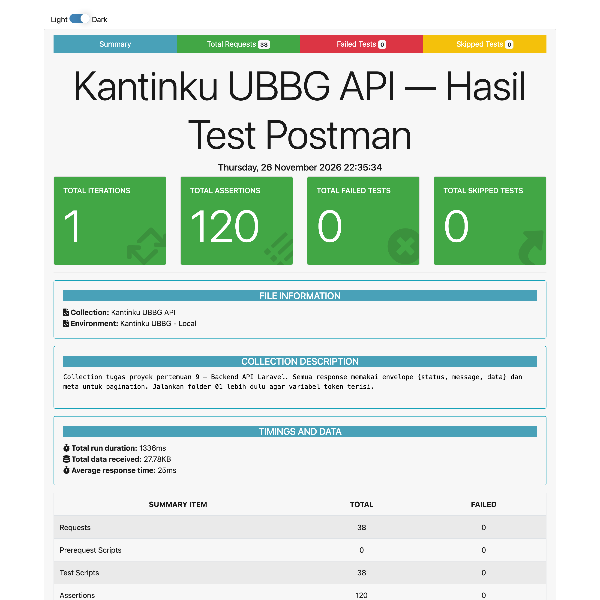

## Cara menjalankan pengujian

```bash
# 1. Siapkan aplikasi
composer install
cp .env.example .env
php artisan key:generate
php artisan migrate:fresh --seed

# 2. Jalankan server
php artisan serve

# 3. Jalankan collection lewat Postman
#    Import docs/postman/Kantinku-UBBG-API.postman_collection.json
#    Import docs/postman/Kantinku-UBBG-Local.postman_environment.json
#    Pilih environment "Kantinku UBBG - Local", lalu Run Collection

# 4. Atau jalankan lewat CLI (Newman)
npx newman run docs/postman/Kantinku-UBBG-API.postman_collection.json \
  -e docs/postman/Kantinku-UBBG-Local.postman_environment.json
```

Kredensial seeder:

| Role | Email | Password |
|---|---|---|
| Admin | `admin@kantinku.test` | `password123` |
| Customer | `susilawati@kantinku.test` | `password123` |

## 10 Test Wajib

### 1. Register berhasil — `201` + token

- **Request:** `POST /api/auth/register`
- **Body:** `name`, `email`, `password`, `password_confirmation`, `phone`
- **Hasil:** `201 Created`, response memuat `data.user` dan `data.token`
- **Status:** PASS

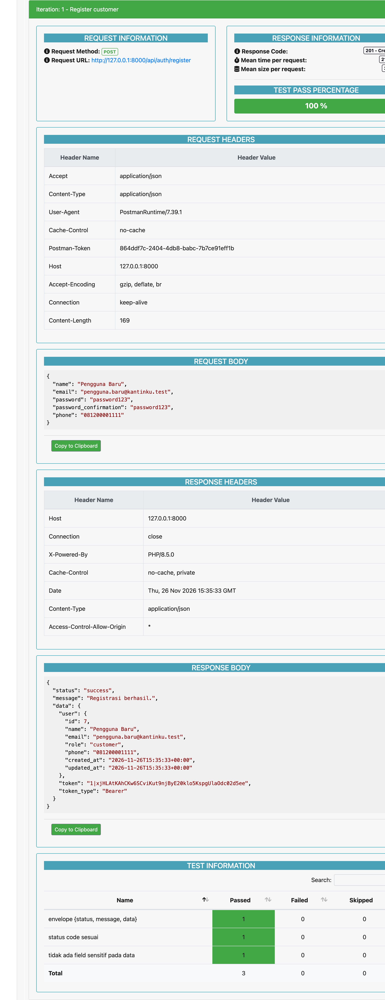

### 2. Login berhasil — `200` + token

- **Request:** `POST /api/auth/login`
- **Body:** `{"email":"admin@kantinku.test","password":"password123"}`
- **Hasil:** `200 OK`, token disimpan otomatis ke variabel environment `token`. Login customer menyimpan `token_customer` untuk uji otorisasi 403.
- **Status:** PASS

### 3. Protected endpoint dengan token — `200`

- **Request:** `GET /api/auth/me` dengan header `Authorization: Bearer {{token}}`
- **Hasil:** `200 OK`, data user login tanpa field `password` / `remember_token`
- **Status:** PASS

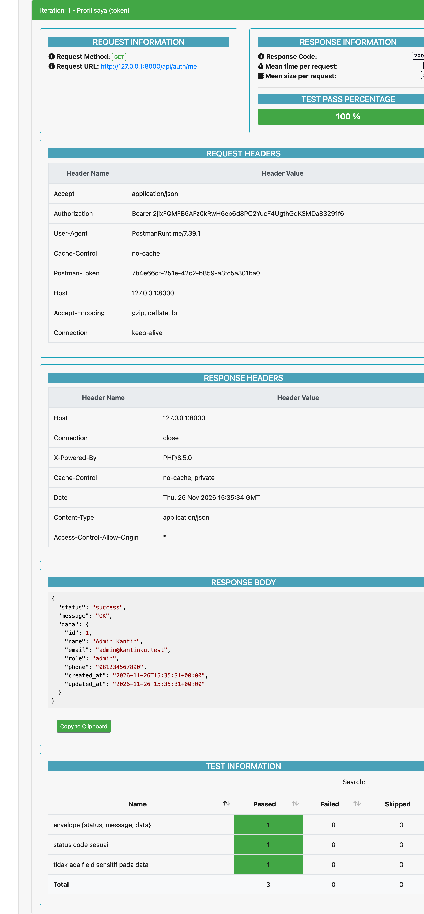

### 4. POST data valid — `201`

- **Request:** `POST /api/orders`
- **Body:** `{"order_type":"dine_in","note":"Tanpa sambal","items":[{"menu_id":1,"quantity":2},{"menu_id":7,"quantity":1}]}`
- **Hasil:** `201 Created`, `order_code` dibuat server, `total_price` dihitung ulang di server, stok menu berkurang
- **Status:** PASS

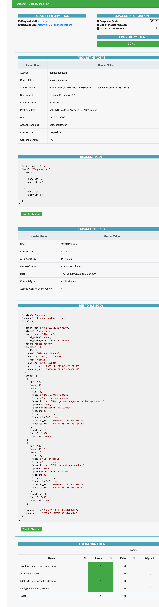

### 5. Data invalid — `422` + detail errors

- **Request:** `POST /api/auth/register` dengan `{"name":"ab","email":"bukan-email","password":"123"}`
- **Hasil:** `422 Unprocessable Content`, `errors` memuat pesan per field (`name`, `email`, `password`)
- **Status:** PASS

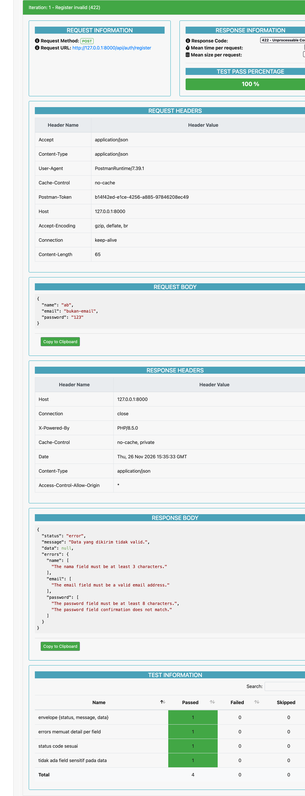

Contoh lain validasi Form Request pada pesanan:

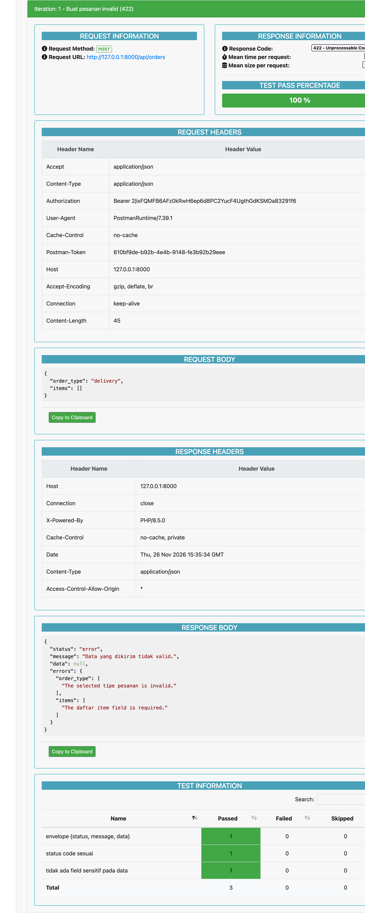

### 6. Request protected tanpa token — `401`

- **Request:** `GET /api/auth/me` tanpa header Authorization
- **Hasil:** `401 Unauthorized`, `{"status":"error","message":"Unauthenticated...","data":null}`
- **Status:** PASS


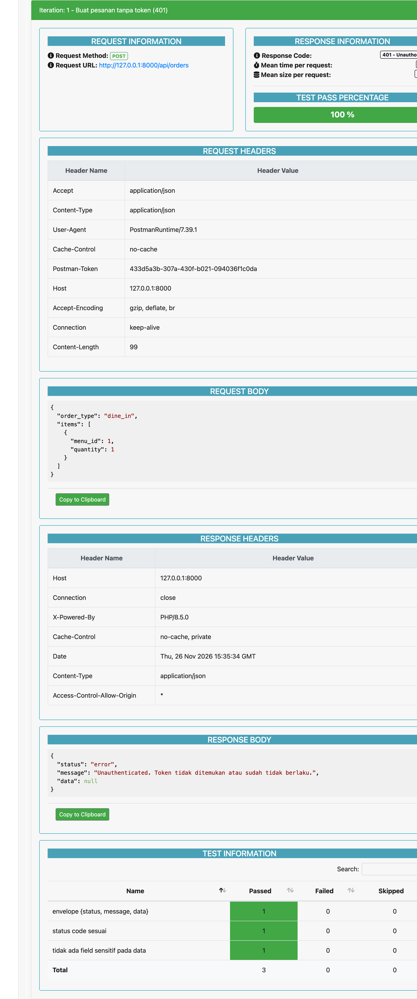

### 7. Resource tidak ditemukan — `404`

- **Request:** `GET /api/categories/kategori-hantu`
- **Hasil:** `404 Not Found`, `{"status":"error","message":"Resource tidak ditemukan.","data":null}`
- **Status:** PASS

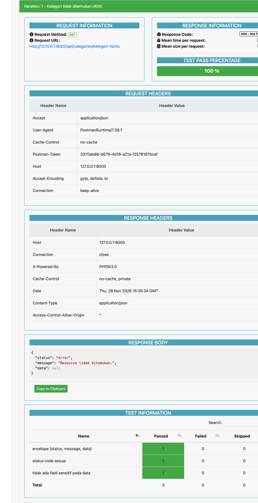

Kasus 404 untuk pesanan milik pengguna lain / ID tidak ada:

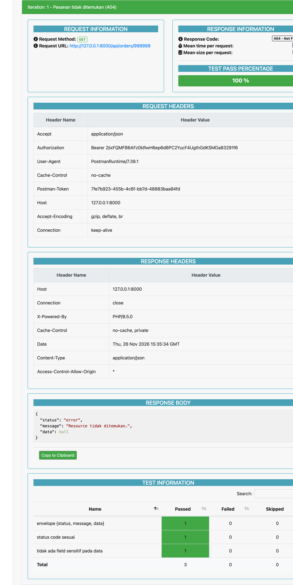

### 8. Response konsisten `{status, message, data}` + `meta` pagination

- **Request:** `GET /api/categories?per_page=5`
- **Hasil:** `200 OK` dengan `meta.current_page`, `meta.per_page`, `meta.total`, `meta.last_page`
- **Status:** PASS

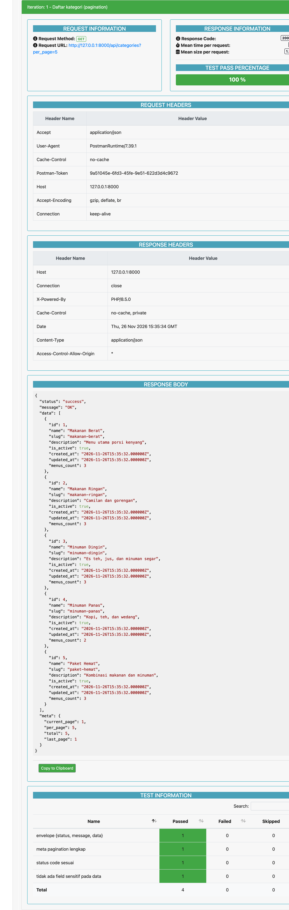

### 9. Tidak ada data sensitif pada response

- **Diuji pada:** seluruh 38 request (assertion otomatis)
- **Cara uji:** test script mengecek `JSON.stringify(response.data)` tidak memuat `password` maupun `remember_token`
- **Hasil:** 38/38 lolos. Semua response user dibentuk lewat `UserResource` yang hanya mengembalikan `id`, `name`, `email`, `role`, `phone`, timestamps
- **Status:** PASS

### 10. Otorisasi admin — `403` untuk non-admin

- **Request:** `POST /api/categories` memakai token customer
- **Hasil:** `403 Forbidden`, `{"status":"error","message":"Akses ditolak. Endpoint ini khusus admin.","data":null}`
- **Status:** PASS

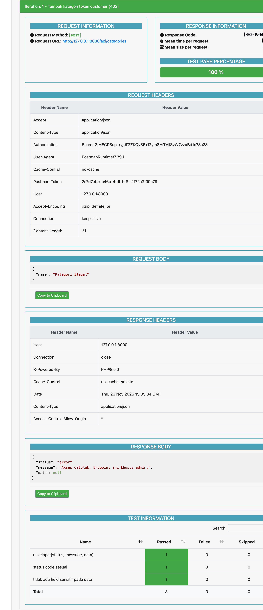

## Daftar Endpoint Aktif

Hasil `php artisan route:list --path=api`:

| # | Method | Endpoint | Akses |
|---|---|---|---|
| 1 | GET | `/api` | Publik |
| 2 | POST | `/api/auth/register` | Publik |
| 3 | POST | `/api/auth/login` | Publik |
| 4 | GET | `/api/auth/me` | Token |
| 5 | POST | `/api/auth/logout` | Token |
| 6 | PUT | `/api/auth/profile` | Token |
| 7 | PUT | `/api/auth/password` | Token |
| 8 | GET | `/api/categories` | Publik |
| 9 | GET | `/api/categories/{slug}` | Publik |
| 10 | GET | `/api/categories/{slug}/menus` | Publik |
| 11 | POST | `/api/categories` | Admin |
| 12 | PUT | `/api/categories/{slug}` | Admin |
| 13 | DELETE | `/api/categories/{slug}` | Admin |
| 14 | GET | `/api/menus` | Publik |
| 15 | GET | `/api/menus/{slug}` | Publik |
| 16 | POST | `/api/menus` | Admin |
| 17 | PUT | `/api/menus/{slug}` | Admin |
| 18 | DELETE | `/api/menus/{slug}` | Admin |
| 19 | GET | `/api/orders` | Token |
| 20 | POST | `/api/orders` | Token |
| 21 | GET | `/api/orders/summary` | Token |
| 22 | GET | `/api/orders/{id}` | Token |
| 23 | GET | `/api/orders/{id}/receipt` | Token |
| 24 | POST | `/api/orders/{id}/items` | Token |
| 25 | PUT | `/api/orders/{id}/items/{item}` | Token |
| 26 | DELETE | `/api/orders/{id}/items/{item}` | Token |
| 27 | PATCH | `/api/orders/{id}/cancel` | Token |
| 28 | DELETE | `/api/orders/{id}` | Token |
| 29 | PATCH | `/api/orders/{id}/status` | Admin |

## Catatan Teknis

- Semua input divalidasi lewat **Form Request** (`app/Http/Requests`), bukan validasi di controller.
- Semua output dibentuk lewat **API Resource** (`app/Http/Resources`) sehingga field sensitif tidak pernah ikut.
- Exception handler di `bootstrap/app.php` menyeragamkan `ValidationException` → 422, `AuthenticationException` → 401, `NotFoundHttpException` → 404.
- Pesanan memakai `DB::transaction` dan menghitung `total_price` di server, bukan dari input client.
